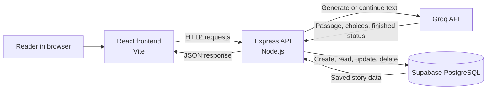

# StoryVerse – AI-Based Interactive Storytelling Agent

StoryVerse is a college project that lets a reader build a branching text story with help from an AI model. The reader provides an idea and genre, reads an opening passage, and chooses what the characters do next. The backend asks Groq to write each continuation and stores the story in Supabase PostgreSQL so it can be reopened later.

Stories can be long and interactive, but writing every branch by hand takes time. StoryVerse provides a simple way to explore story directions one choice at a time while keeping the story history available for later.

## Key Features

- Generate an opening passage from a user-provided idea and genre.
- Choose from the genres supported by the interface, including Fantasy, Horror, Romance, Mystery, Sci-Fi, and Adventure.
- Select from AI-generated choices to guide the next passage.
- Continue a saved story with Groq and store each new passage in the same database record.
- Include previous passages and the selected choice in the continuation prompt to encourage consistent characters, events, and genre.
- Save stories in Supabase and reopen them later to resume reading and continue.
- View story history, filter stories by status, and delete stories.

Consistency is guided through the prompt sent to the AI; generated text is not guaranteed to preserve every detail perfectly. StoryVerse currently stores and displays text. Illustrations and voice narration are not implemented.

## Technology Stack

| Technology | Role |
| --- | --- |
| React | Builds the interactive user interface. |
| Vite | Runs the frontend development server and builds frontend files. |
| Tailwind CSS | Provides utility classes for styling, alongside the project's custom CSS. |
| Node.js | Runs the backend JavaScript server. |
| Express.js | Defines the HTTP API used by the frontend. |
| Groq API | Generates story passages and choices. |
| Supabase PostgreSQL | Stores story records in a PostgreSQL database. |

## Project Architecture

The browser runs the React application. The frontend sends HTTP requests to the Express API. For creating or continuing a story, Express calls Groq, then saves the result in Supabase. For listing, opening, and deleting stories, Express reads or changes the Supabase records directly. Groq and Supabase credentials stay on the backend.



## Project Folder Structure

```text
storyverse/
├── index.html                 # Vite page entry point
├── package.json               # Dependencies and project commands
├── package-lock.json          # Locked dependency versions
├── vite.config.js              # Vite, React, and Tailwind plugin setup
├── .gitignore                  # Excludes local secrets and generated files
├── .env                        # Local environment variables (create this file)
├── server/
│   ├── server.js               # Express API, Groq calls, and Supabase operations
│   └── schema.sql              # SQL to create the stories table
└── src/
    ├── main.jsx                # Mounts the React application
    ├── App.jsx                 # Pages and frontend story workflows
    ├── api.js                  # Fetch helpers for the backend API
    ├── index.css               # Tailwind import and custom styles
    ├── assets/
    │   └── hero.png            # Frontend image asset
    └── data/
        └── sampleStories.js    # Genre and sample data used by the interface
```

`node_modules/` contains installed dependencies and `dist/` is generated by a production build. Neither is source code to edit. The `.env` file is local configuration and should not be committed.

## Installation and Setup

### Prerequisites

- Node.js 20.19+ or 22.12+ and npm. Check the installed versions with `node --version` and `npm --version`.
- A Groq account and API key.
- A Supabase project.
- Git if you are cloning the project. Alternatively, download and extract the project files.

### Get the project and install dependencies

If the project is in a Git repository, replace the placeholder below with its repository address:

```bash
git clone <your-repository-url>
cd <project-folder>
```

If you downloaded a ZIP, extract it and open a terminal in the extracted project root (the folder containing `package.json`). Then install the dependencies:

```bash
npm install
```

### Create the Supabase table

In the Supabase dashboard for your project, open the SQL Editor, paste the contents of `server/schema.sql`, and run the SQL. It creates the `public.stories` table if it does not already exist. The table uses PostgreSQL's `jsonb` type to store the passage and choice data together.

### Configure environment variables

Create a file named `.env` in the project root, alongside `package.json`. Add the variables shown below and replace each placeholder with your own project values. Do not add quotation marks unless a value requires them.

```dotenv
PORT=3000
CLIENT_URL=http://localhost:5173
GROQ_API_KEY=your_groq_api_key
GROQ_MODEL=openai/gpt-oss-20b
SUPABASE_URL=https://your-project-ref.supabase.co
SUPABASE_SECRET_KEY=your_supabase_secret_key
VITE_API_URL=http://localhost:3000
```

The code reads `CLIENT_URL` to configure Express CORS (which controls which browser origin may call the API). `CLIENT_ORIGIN` is not read by the current backend. `VITE_API_URL` is optional: the frontend uses `http://localhost:3000` if it is not set. Vite exposes variables prefixed with `VITE_` to frontend code, so only put non-secret values in such variables.

## Environment Variables

| Variable | Purpose |
| --- | --- |
| `GROQ_API_KEY` | Secret key used by the backend to authenticate requests to Groq. |
| `GROQ_MODEL` | Groq model name used for story generation. The current backend defaults to `openai/gpt-oss-20b` when this variable is omitted. |
| `SUPABASE_URL` | URL of the Supabase project used by the backend. |
| `SUPABASE_SECRET_KEY` | Supabase secret key used by the backend to access the database. Keep it private; it has elevated access. |
| `PORT` | Port for the Express server. The local setup above uses `3000`. |
| `CLIENT_ORIGIN` | This name is not used by the current code. Set `CLIENT_URL` to the frontend origin instead (locally, `http://localhost:5173`). |
| `VITE_API_URL` | Optional frontend base URL for the Express API. It defaults in `src/api.js` to `http://localhost:3000`. |

## How to Run the Project

Run the backend and frontend in separate terminals from the project root. Keep both terminals open while using the application.

**Terminal 1 — backend:**

```bash
npm run server
```

This runs `server/server.js`. The API uses port `3000` unless `PORT` is configured to another value.

**Terminal 2 — frontend:**

```bash
npm run dev
```

Vite prints the local frontend address in the terminal; by default it is `http://localhost:5173`.

To create a production frontend build, use `npm run build`. This command writes generated files to `dist/`.

## API Documentation

The API base URL in the local setup is `http://localhost:3000`. Requests and successful JSON responses use JSON unless otherwise noted. In the routes below, `:id` means the UUID of a saved story.

| Method and path | Purpose | Successful response |
| --- | --- | --- |
| `POST /api/stories` | Generate an opening passage and choices, then save a new story. | `201` with `{ "story": { ... } }` |
| `POST /api/stories/:id/continue` | Continue the saved story using the selected choice, update its record, and return it. | `200` with `{ "story": { ... } }` |
| `GET /api/stories` | List saved stories, ordered by most recently updated. | `200` with `{ "stories": [ ... ] }` |
| `GET /api/stories/:id` | Fetch one saved story and its passages and choices. | `200` with `{ "story": { ... } }` |
| `DELETE /api/stories/:id` | Delete one saved story. | `204` with an empty response body |

### Create a story

Request body:

```json
{
  "idea": "A cartographer finds a map that changes whenever someone lies",
  "genre": "Mystery"
}
```

`idea` is the user's starting theme or premise; `genre` is the selected genre. The response's `story` includes the saved story fields, passages, current choices, and finished status.

### Continue a story

Request body:

```json
{
  "choice": "Ask the lighthouse keeper who drew the map"
}
```

The backend finds the story by `:id`, sends its earlier passages and the selected choice to Groq, and updates the existing record with the generated passage and next choices (or ending status).

### Example commands

These examples use `curl`, which is available in many terminals. Replace `<story-id>` with an ID returned by the API.

```bash
curl -X POST http://localhost:3000/api/stories \
  -H "Content-Type: application/json" \
  -d '{"idea":"A map that changes when someone lies","genre":"Mystery"}'
```

```bash
curl -X POST http://localhost:3000/api/stories/<story-id>/continue \
  -H "Content-Type: application/json" \
  -d '{"choice":"Question the lighthouse keeper"}'
```

```bash
curl http://localhost:3000/api/stories
curl http://localhost:3000/api/stories/<story-id>
curl -X DELETE http://localhost:3000/api/stories/<story-id>
```

Requests with missing or invalid input can return an error response. A story that does not exist returns `404`; missing service configuration, Groq errors, or database errors are reported by the backend with an appropriate error status.

## Database Structure

The SQL file creates one table: `public.stories`.

| Column | Type | Purpose |
| --- | --- | --- |
| `id` | UUID | Primary key that uniquely identifies a story; generated by the database. |
| `title` | TEXT | Story title. |
| `theme` | TEXT | User's original story idea or premise. |
| `genre` | TEXT | Selected story genre. |
| `content` | JSONB | Structured story data, including passages and choices. It defaults to empty passage and choice arrays. |
| `summary` | TEXT | Summary text maintained for the story. |
| `is_finished` | BOOLEAN | Whether the AI has marked the story as finished. Defaults to `false`. |
| `created_at` | TIMESTAMPTZ | When the row was created, with time-zone information. |
| `updated_at` | TIMESTAMPTZ | When the row was last updated, with time-zone information. |

The table has Row Level Security (RLS) enabled by `schema.sql`. The backend uses the Supabase secret key for its database requests. There is no user authentication or per-user story ownership in the current project, so the API does not separate stories by user.

## How the Application Works

1. The reader enters a story idea and selects a genre on the Create Story page.
2. The React frontend sends `idea` and `genre` to `POST /api/stories`.
3. Express asks Groq for structured story output: a passage, choices, and a finished indicator. The backend saves the new story to Supabase and returns it to the frontend.
4. The Reading page displays the passages and choices. When the reader chooses an option, the frontend sends it to `POST /api/stories/:id/continue`.
5. Express loads the existing record and asks Groq to continue from the previous passages according to the selected choice. It updates that same Supabase record with the new passage, choices, summary, and finished status.
6. The frontend displays the updated story. The reader can later open it from My Stories; the saved passages and current choices are loaded so the reader can resume.
7. My Stories also allows the reader to filter the list and delete a saved story.

The application requests structured output from Groq and uses the prior story content as context. AI output can still vary and may not always follow every continuity detail exactly.

## Future Enhancements

These are possible future additions and are not part of the current implementation:

- AI-generated illustrations for story scenes.
- Voice narration for passages.
- More explicit support for exploring and managing multiple endings.
- User accounts and private, per-user story libraries.

## Security Notes

- Keep `.env` private. The project's `.gitignore` excludes it; do not remove that entry or commit the file.
- Never put the Groq API key or Supabase secret key in React files, browser requests, screenshots, or public repositories.
- The backend reads these secrets from environment variables and makes the service requests. `VITE_` variables are bundled for browser use and must not contain secrets.
- The Supabase secret key has elevated access. Protect it and use it only in the backend environment.
- This project does not implement authentication, so anyone able to reach the API can use its story operations. Configure access appropriately before deploying it publicly.

## Author and Project Information

**Project:** StoryVerse – AI-Based Interactive Storytelling Agent  
**Type:** College project  
**Author(s):** [Add your name(s)]  
**Course / Department:** [Add course or department]  
**Institution:** [Add institution name]  
**Academic year:** [Add academic year]
